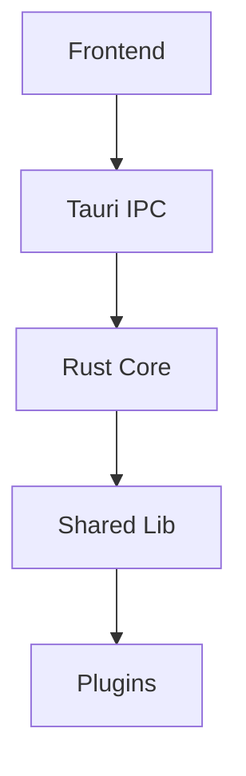

# Project Name

<div align="center">


</div>

---

## One-liner Description

**Tagline** — What problem does this solve?

<div align="center">

[](https://github.com/earnerbaymalay/PROJECT_NAME)
[](https://github.com/earnerbaymalay/PROJECT_NAME/issues)
[](https://github.com/earnerbaymalay/PROJECT_NAME/discussions)

</div>

---

## Features

- Feature 1: Description
- Feature 2: Description
- Feature 3: Description

## Quick Start

```bash
# Minimal working example
git clone https://github.com/earnerbaymalay/PROJECT_NAME
cd PROJECT_NAME
./build.sh dev
```

## Installation

### Prerequisites

- **Rust**: 1.75+ ([rustup](https://rustup.rs/))
- **Node.js**: 20+ ([nvm](https://github.com/nvm-sh/nvm) / [fnm](https://github.com/Schniz/fnm))
- **Tauri Prerequisites**: See [Tauri docs](https://tauri.app/v1/guides/getting-started/prerequisites)

### Build

```bash
# Linux/macOS/WSL
./build.sh build

# Windows
build.cmd build
```

## Usage

```bash
# Basic usage
./build.sh dev          # Development mode
./build.sh build        # Production build
./build.sh test         # Run tests
./build.sh lint         # Lint code
./build.sh format       # Format code
```

## Configuration

```toml
# config.toml
[app]
name = "My App"
version = "0.1.0"
identifier = "com.example.myapp"

[window]
title = "My App"
width = 1200
height = 800

[security]
csp = "default-src 'self'; script-src 'self' 'unsafe-inline'"
devtools = false
```

## Architecture



## Tech Stack

`Rust` `TypeScript` `Tauri 2` `Vite` `Ollama` `llama.cpp` `SQLite`

## Project Structure

```
PROJECT_NAME/
├── Cargo.toml              # Workspace root
├── tauri.conf.json         # Tauri configuration
├── build.sh / build.cmd    # Build scripts
├── .github/workflows/      # CI/CD
├── crates/
│   ├── app/                # Tauri entry point
│   ├── core/               # Business logic
│   ├── cli/                # CLI binary
│   └── shared/             # Shared utilities
├── frontend/               # TypeScript + Vite
└── docs/                   # Documentation
```

## Development

```bash
# Install dependencies
cd frontend && npm install

# Development
./build.sh dev

# Code quality
./build.sh lint
./build.sh format
./build.sh test
```

## Testing

```bash
# Rust tests
cargo test --workspace

# Frontend tests
cd frontend && npm test
```

## CI/CD

| Workflow | Status |
|----------|--------|
| CI |  |
| Release |  |
| Pages |  |

## License

MIT OR Apache-2.0

---

<div align="center">

**Built with Nocta aesthetic** · Fonts: Geist / Geist Mono · Accent: `#d4a843` · Dark-only, always

Deployed via GitHub Pages from [`earnerbaymalay/PROJECT_NAME`](https://github.com/earnerbaymalay/PROJECT_NAME)

</div>